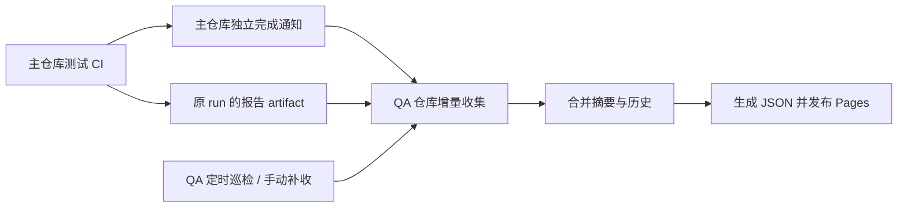

# Asterinas QA 页面设计

建设一个公开的 QA 站点，集中展示 main 分支的 CI 状态、测试结果、Linux API 支持程度和性能数据。
计划将源码、数据收集和发布逻辑放在独立仓库 `asterinas/qa`，通过 GitHub Pages 发布。
浏览器读取生成后的静态 JSON，不需要账户、GitHub token 或常驻后端。
下文中，“主仓库”指 `asterinas/asterinas`，“QA 仓库”指 `asterinas/qa`。

交互与视觉设计预览：[cqs21.github.io/qa](https://cqs21.github.io/qa/)。
预览用于讨论页面布局与展示方式；页面功能、数据接入和自动更新的实现范围见下文设计与改造计划。

## 1. 页面与模块

### Overview

- **Main workflows**：统计 main 上所有启用 workflow 的最新已完成结果，显示成功、失败、其他结果和无记录的数量，
  按结果分组直接列出所有 workflow；每项提供名称、commit、执行时间和 GitHub Actions run 链接。
  有架构区别时补充各架构的 job 统计，否则直接展示 workflow 结果。取消等其他结果不计为失败。
- **Test coverage 矩阵**：行是测试大类，列是架构或执行平台，单元格展示各配置最近执行的结果摘要，并能进入测试详情。
  覆盖 x86-64、Intel TDX、AArch64、RISC-V 64、LoongArch 64 等实际 CI 范围；只有构建检查的平台明确标为 build-only。
- **API 与性能摘要**：显示 syscall 支持情况和选定性能指标，并链接到对应详细页面。

### Test coverage

- **测试分类与筛选**：覆盖基础检查、boot、regression、kernel/ktest、OSDK、LTP、gVisor、kselftest、xfstests、pjdfstest、NixOS 等，
  支持按架构、测试类别、配置和结果筛选。lint/compile 与实际运行测试分别标识。
- **NixOS 子分类**：NixOS 与 LTP、gVisor 同为一个大类，minimal、full 测试集下的各应用测试套件作为子项，各自维护执行记录和原生计数。
- **Execution records**：每个测试配置展示最新实际执行和此前最近一次成功执行，各自包含状态、commit、时间、workflow/run/job 链接及 **Native log counts**。
  原生计数统一放在执行记录中，计数范围和单位在详情中说明。
- **执行详情**：展示配置参数、执行阶段、失败或阻断原因、原生计数的范围与单位，以及报告和日志入口。

这里的 coverage 表示测试范围与执行结果，不表示源码行覆盖率。
不同测试套件（suite）及其执行配置（config，如架构、平台和 SMP 参数）的结果可以来自不同 workflow、commit 和时间。
页面按套件和配置汇总，各记录分别注明来源与时间。

### API coverage

- **支持统计与列表**：按架构展示 syscall 名称、类别及完整支持、部分支持、未支持、未评估状态。
- **Flags 与限制详情**：列出支持、尚未支持和静默忽略的 flags/模式，以及对应说明和 SCML（System Call Matching Language，用于声明支持的 syscall 调用模式）。
- **搜索与来源**：支持按 syscall、flags、类别和状态筛选，显示 Book 来源提交及文档链接。

这部分表达文档声明的兼容范围；没有关联测试证据时，不将其解释为运行验证覆盖率。

### Performance

- **指标对照**：并列展示 Asterinas/Linux 原值、单位、优劣方向、配置与来源时间。
- **历史变化**：查看选定指标的历史数据和对应记录，提供数据表格与 benchmark 详细页面入口。
- **方法与可比性**：展示可获得的环境和测量方法；缺值保留缺口，环境未知或不一致时不生成性能倍率或连续趋势结论。

可展示的性能指标示例：

| 指标 | benchmark metric ID | 展示目的 |
| --- | --- | --- |
| Process fork | `process_fork_lat` | 进程创建与退出延迟 |
| SMP wakeup | `smp8_p99_wakeup_latency` | 多核唤醒的 P99 延迟 |
| Ext2 sequential read | `ext2_seq_read_bw_direct` | 文件系统直接读取吞吐 |
| TCP throughput | `tcp_virtio_bw` | VirtIO 网络吞吐 |
| Redis GET | `get_100k_conc20_rps` | 应用请求吞吐 |
| Boot | `boot_lat` | 最小 initramfs 启动耗时 |

### Methods & data

说明数据来源、测试分类、状态含义、原生计数单位、更新与历史保留规则，以及已知缺口。
分别显示 CI、API 声明和性能数据的来源版本与时间，并提供摘要下载及 Actions、Book、benchmark 的追溯入口。
执行时间、来源更新时间和页面生成时间分别表达；页面重新发布不会使旧结果变成新结果。

所有页面支持可分享的筛选/详情链接、窄屏布局和键盘操作；图表提供等价数据表格。

## 2. 数据来源与格式

| 数据 | 权威来源 | QA 使用方式 |
| --- | --- | --- |
| Workflow 与 job 状态 | `asterinas/asterinas` 的 workflow 定义和 GitHub Actions API | 发现启用清单，读取 main run/attempt/job 的状态、commit、时间和链接 |
| 测试结果与原生计数 | CI 生成的本次测试报告、原生套件报告及必要日志 | 提取配置、执行结果和计数；优先读取结构化报告，必要时按套件解析日志 |
| API 支持声明 | 主仓库 main 的 `book/src/kernel/linux-compatibility/` 表格、说明和 SCML | 从同一提交读取并转换为 syscall/flags 展示数据 |
| 性能 | [asterinas/benchmark](https://github.com/asterinas/benchmark) 已发布的数据 | 仅选取并展示既有指标和历史，不另外运行或建立第二套性能采集流程 |

以下 JSON 仅示意需要保留的信息，数值和标识为示例，不是完整 schema，也不代表实际执行结果。
实现时约定版本化数据格式；CI 执行报告与 QA 生成的跨 workflow 页面数据分别维护。

### 测试执行报告示例

每份报告记录一个测试配置的一次执行，关联到主仓库的 workflow 执行（run）、执行尝试编号（run_attempt，重跑时递增）、任务（job）和实际测试提交。
测试配置使用稳定标识并保留实际参数，不能仅依赖 job 的显示名称。
`source_sha` 为触发 workflow 的提交，`tested_sha` 为实际被测提交，两者分别记录。

#### NixOS 应用测试套件

```json
{
  "example": true,
  "source": {
    "repository": "asterinas/asterinas",
    "branch": "main",
    "event": "push",
    "workflow": ".github/workflows/test_nixos_full.yml",
    "run_id": 123456789,
    "run_attempt": 1,
    "job_id": 987654321,
    "source_sha": "1111111111111111111111111111111111111111",
    "tested_sha": "1111111111111111111111111111111111111111"
  },
  "category": "nixos",
  "test_id": "nixos/web-servers-and-proxies",
  "config_id": "x86_64-qemu-smp4",
  "config": { "arch": "x86_64", "platform": "qemu", "smp": 4 },
  "job_conclusion": "success",
  "result": "passed",
  "started_at": "2026-11-10T10:00:00Z",
  "finished_at": "2026-11-10T10:10:00Z",
  "native_counts": { "unit": "top-level case", "passed": 4, "failed": 0 }
}
```

#### LTP syscall 测试套件

下面示例展示一次存在失败及 broken 结果的执行，沿用相同的来源与配置字段：

```json
{
  "example": true,
  "source": {
    "repository": "asterinas/asterinas",
    "branch": "main",
    "event": "push",
    "workflow": ".github/workflows/test_x86.yml",
    "run_id": 123456790,
    "run_attempt": 1,
    "job_id": 987654322,
    "source_sha": "4444444444444444444444444444444444444444",
    "tested_sha": "4444444444444444444444444444444444444444"
  },
  "category": "ltp",
  "test_id": "ltp/syscalls",
  "config_id": "x86_64-qemu-release-multiboot2-smp4-kvm",
  "config": {
    "arch": "x86_64",
    "platform": "qemu",
    "mode": "release",
    "boot_protocol": "multiboot2",
    "smp": 4,
    "enable_kvm": true
  },
  "job_conclusion": "failure",
  "result": "failed",
  "started_at": "2026-11-10T11:00:00Z",
  "finished_at": "2026-11-10T11:20:00Z",
  "native_counts": {
    "unit": "LTP subtest result",
    "passed": 1200,
    "failed": 2,
    "broken": 1,
    "skipped": 35,
    "warnings": 0
  }
}
```

LTP 的原生计数来自 LTP/Kirk 报告，分别保留通过、失败、测试异常（broken）、跳过和警告数量。
一个测试程序可能包含多个子测试结果，这些计数不等同于顶层测试程序数。

Job 结论和原生测试计数分别保留；cases、assertions、files 等不同单位不跨套件相加为总体通过率。
例如 NixOS 只统计宿主测试框架的顶层 case，不混入应用内部的 assertions。
构建失败或取消导致未产生完整摘要时，计数为 `null` 并说明原因，不补成零；已有完整摘要仍按实际保留。
准备/构建错误、测试失败、取消、跳过、被前置阻断、缺报告和未知应能区分。

### API 声明转换示例

```json
{
  "example": true,
  "source_repository": "asterinas/asterinas",
  "source_sha": "2222222222222222222222222222222222222222",
  "arch": "x86_64",
  "syscall": "pipe2",
  "status": "partial",
  "supported_flags": ["O_CLOEXEC"],
  "ignored_flags": ["O_DIRECT", "O_NONBLOCK"],
  "scml": "pipe2(pipefd, flags = O_CLOEXEC);"
}
```

API 条目保留来源链接和限制说明；不同架构的 syscall 编号与声明独立处理。

### 性能数据转换示例

```json
{
  "example": true,
  "source_repository": "asterinas/benchmark",
  "source_ref": "gh-pages",
  "source_revision": "3333333333333333333333333333333333333333",
  "metric_id": "boot_lat",
  "platform": "x86-64",
  "source_date": "2026-11-10T09:00:00Z",
  "tested_sha": null,
  "unit": "sec",
  "direction": "lower_is_better",
  "values": { "asterinas": "0.82", "linux": "1.05" },
  "comparability": "unknown"
}
```

保留源单位、原始数值和可获得的环境信息。benchmark 的发布版本与被测内核提交分别记录，未知信息不推测补齐。

## 3. 结果选择与历史

- **CI 数据范围**：仅接收主仓库 main 分支由 `push`、`schedule` 或 `workflow_dispatch` 触发的执行；PR、fork 和其他分支的执行不更新 QA 数据。
- **Workflow 概览**：每个启用 workflow 取符合上述来源条件的最新一次已完成 run，保留其原结论与来源链接。
- **测试矩阵**：每个测试套件的各个配置分别取最新实际执行。新 run 未选择某项、显式跳过或取消前尚未执行时，保留该项旧记录。
- **上一次成功**：选择同配置、严格早于最新执行的独立成功记录，跳过中间失败；也可以来自同一提交的更早 attempt。
  最新失败仍显示失败，历史中找不到成功时显示未知。
- **重跑与乱序**：同一执行重复采集不重复计数；重跑沿用的旧 job 仍指向原执行；旧 run 晚完成不能覆盖更新 run。

QA 持久保存小型执行摘要、历史与索引，建议放在 QA 仓库独立数据分支，避免结果提交混入源码历史。
摘要保留目标为至少 90 天；仍被最新结果或上次成功引用的记录继续保留。
完整日志和构建产物主要留在 Actions，过期时标明证据不可得，摘要仍可查询；无需归档每次 API 响应或将全部日志随站点发布。

## 4. CI 如何更新 QA 页面

主仓库的 CI 将测试报告作为 artifact 上传到对应的 workflow run；执行完成后，由独立 workflow 通知 QA 仓库收集。
QA 仓库负责合并结果、生成页面数据并发布站点。



1. **测试 CI 产出报告**：各 job 上传本次结果到原 run 的 artifact，使用可区分 attempt/job/config 的名称和报告身份。
   普通失败也尽力上传；整次取消或 runner 丢失无法生成报告时，保留平台状态和报告缺口。
2. **独立 workflow 发送通知**：主仓库使用 `workflow_run: completed` 监听需要展示的 workflow，校验源仓库、main 和原始事件后通知 QA。
   成功、失败、超时、取消都接收，不依赖原测试最后一个步骤执行。
3. **QA 增量收集**：QA workflow 根据通知重新核验主仓库对应的 run、run_attempt 和 jobs，通过 GitHub API 下载报告和必要日志。
   优先收集本次新增数据，结合已保存的同步进度补齐遗漏，不必每次重新下载全部历史。
4. **统一合并与发布**：QA 串行合并历史，校验并保存数据，生成页面 JSON，再部署 GitHub Pages。
   测试 CI 不直接修改 QA 汇总文件，浏览器也不直接查询 Actions API。

跨仓通知使用 `POST /repos/asterinas/qa/dispatches`，QA 监听 `repository_dispatch`：

```json
{
  "event_type": "ci-run-completed",
  "client_payload": {
    "repository": "asterinas/asterinas",
    "run_id": 123456789,
    "run_attempt": 1
  }
}
```

通知只传执行标识，报告保存在源 run；QA 仓库不能直接通过 `workflow_run` 监听另一个仓库。
通知成功不等于页面已更新。QA 设置约 10 分钟的定时补采与手动入口，恢复漏通知、排队取消、暂时失败和晚到报告。
重复通知应可去重；只有持久化成功才推进同步进度，API 故障时保留旧数据并显示更新缺口。

API 和性能独立刷新：主仓库 main 修改 `book/src/kernel/linux-compatibility/**` 时通知 QA 重建 API 声明，无需等待测试；
QA 定期读取 benchmark 发布版本，也可在 benchmark 发布后接收通知。
三类更新进入同一合并/发布流程，保留各自版本和时间，互不覆盖较新的数据。

权限分为主仓库通知 QA、QA 只读源仓库、QA 自身写数据和部署 Pages；默认 `GITHUB_TOKEN` 不自动具备跨仓权限。
通知凭据只用于独立通知 workflow，不下发给测试 job 或浏览器。
正常更新以数据可获得后 30 分钟内公开可见为目标；定时任务可能延迟，需试运行验证，更新失败不改变原测试结果。

## 5. 改造计划

### 1. 建立 QA 站点与数据约定

前置：无。

PR 修改内容：

- 在 `asterinas/qa` 建立五个页面及其模块，使用明确标记的示例数据评审布局、筛选和执行详情。
- 约定版本化测试报告与页面数据格式，明确套件和配置标识、来源字段、执行状态及原生计数的含义。
- 接入静态 GitHub Pages 发布，配置源码、数据和部署所需的仓库设置。

验收目标：

- [ ] 五个页面可通过预览地址访问，筛选和详情可分享链接，窄屏及键盘操作可用。
- [ ] NixOS、LTP、API 和性能示例可按约定格式展示，示例数据与真实结果有明确区分。
- [ ] 浏览器只读取公开静态数据，无需账户或 GitHub token。

### 2. 接入 CI 测试报告与完成通知

前置：步骤 1。

PR 修改内容：

- 在 `asterinas/asterinas` 为基础检查、各测试套件及 NixOS 子套件输出本次报告，关联实际配置、被测提交、阶段结果和原生计数。
- 将报告上传到源 run 的 artifact，区分 attempt、job 和配置；测试失败时尽力保存报告，缺失时保留原因。
- 增加独立的完成通知 workflow，校验主仓库、main 分支及原始事件，通过 `repository_dispatch` 通知 QA 仓库，配置必要的跨仓凭据。

验收目标：

- [ ] NixOS 与 LTP 等不同套件的报告可追溯到实际 job、配置及提交，计数单位正确，原有测试失败判定保持有效。
- [ ] 成功、失败、超时和取消都能触发通知；PR、fork 和非 main 分支不会更新 QA 数据。
- [ ] 通知凭据不下发给测试 job，通知或 QA 更新失败不改变原 CI 结果。

### 3. 实现 QA 增量收集、历史与自动发布

前置：步骤 1；真实 CI 联调依赖步骤 2，可按约定格式并行开发。

PR 修改内容：

- 在 `asterinas/qa` 接收通知并重新核验来源，通过 GitHub API 收集全部启用 workflow 的状态、测试报告及必要日志。
- 持久保存摘要与历史，按测试套件和配置选择最新实际执行及上一次成功，处理重跑、重复通知和乱序完成。
- 增加定时补采和手动入口，串行合并数据并统一发布 Pages，配置数据写入和部署权限。

验收目标：

- [ ] Overview 正确统计各 workflow 的最新结果；测试矩阵保留本次未执行项的旧记录，最新失败时能找到同配置的上一次成功。
- [ ] 重跑、重复通知和旧 run 晚完成不会重复计数或覆盖更新结果；历史保留符合约定。
- [ ] 漏通知、报告晚到、API 暂时失败和发布失败后可以恢复；页面显示来源与更新时间，更新延迟符合目标。

### 4. 接入 API 声明与性能数据

前置：步骤 1；自动刷新与发布联调依赖步骤 3，解析和展示可并行开发。

PR 修改内容：

- 在 `asterinas/qa` 解析 Book 的 syscall 表格、flags 说明和 SCML；在 `asterinas/asterinas` 增加 main 分支兼容性文档变更通知。
- 读取 `asterinas/benchmark` 已发布的指标与历史，支持配置展示范围，保留单位、来源时间和可获得的环境信息。
- 将两类数据接入统一合并与发布流程，实现独立刷新、来源追溯和筛选；benchmark 发布通知作为可选补充。

验收目标：

- [ ] main 更新兼容性文档后，API 页面随之更新；支持状态、flags 和 SCML 可追溯到同一来源提交。
- [ ] 性能指标可核对源值、单位及历史，缺失或不可比的数据有明确说明。
- [ ] CI、API 和性能可以分别刷新并保留各自版本，更新其中一类不会覆盖其他类的新数据。
